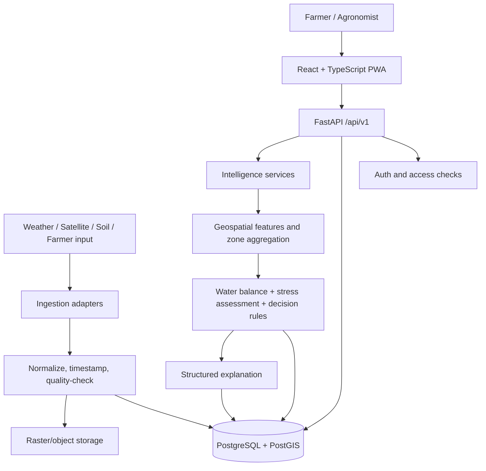

# System Architecture

**Architecture style:** Modular monolith with separate frontend and backend applications.  
**Primary pattern:** Provider adapters → normalized observations → intelligence services → persisted assessment/recommendation → versioned REST API → mobile UI.

## 1. High-level architecture



## 2. Architectural principles

- Modular monolith first; avoid microservices for the MVP.
- API routes are thin and delegate to services.
- External providers are accessed through adapters.
- Ingestion and intelligence are separate responsibilities.
- Persist source observations, analysis runs and recommendation versions.
- Use PostGIS for farm/zone geometry and spatial operations.
- Store large raster assets outside relational rows; database stores references and metadata.
- Use deterministic calculations and rules for water recommendations.
- LLMs, if added, only verbalize validated structured results.
- Frontend has no provider credentials and no direct access to private data stores.

## 3. Target repository structure

```text
farmshield-ai/
├── AGENTS.md
├── README.md
├── docs/
├── frontend/
│   ├── public/
│   ├── src/
│   │   ├── app/
│   │   ├── design-system/
│   │   ├── components/common/
│   │   ├── features/
│   │   │   ├── onboarding/ dashboard/ farm-map/ zones/
│   │   │   ├── irrigation/ recommendations/ insights/
│   │   │   ├── alerts/ history/ profile/ settings/
│   │   ├── i18n/locales/{en,mr,hi}/
│   │   ├── lib/api/
│   │   ├── lib/utils/
│   │   └── types/
│   ├── tests/
│   └── package.json
├── backend/
│   ├── app/
│   │   ├── main.py
│   │   ├── api/v1/
│   │   ├── core/
│   │   ├── db/
│   │   ├── models/
│   │   ├── schemas/
│   │   ├── services/
│   │   ├── ingestion/{providers,pipelines,normalizers}/
│   │   ├── data_quality/
│   │   └── intelligence/{features,agronomy,stress,decision,explanations}/
│   ├── migrations/
│   ├── tests/
│   └── pyproject.toml
├── data/{samples,fixtures,manifests}/
├── scripts/
├── infra/{docker}/
└── .github/workflows/
```

Use multiple files/lines rather than making every module one giant file. The compact tree above is illustrative of the folder families.

## 4. Frontend architecture

- React + TypeScript + Vite.
- Feature-based folders owned by Disha/Vidula.
- Shared design tokens and common components are owned by Disha.
- Feature pages use typed API client functions; no raw fetch logic scattered through components.
- i18next for English (`en`), Marathi (`mr`) and Hindi (`hi`).
- React Leaflet for map display; keep large geospatial processing out of the browser.
- Chart.js for compact trends; every chart has a textual summary.
- PWA support for installability and selected cached assets. Offline write queues are a later implementation unless the MVP requires them.
- API base URL and public configuration via environment variables. No provider secrets in Vite variables.

## 5. Backend architecture

FastAPI package boundaries:

- `api/v1`: HTTP routing, dependency wiring, request/response validation.
- `core`: settings, security helpers, logging and constants.
- `db`: SQLAlchemy engine, session and base metadata.
- `models`: persistence entities (owned by Chaitanya).
- `schemas`: Pydantic API contracts (owned by Chaitanya; shared review required).
- `services`: farm, zone, analysis, recommendation and event orchestration.
- `ingestion/providers`: provider-specific HTTP/SDK access (Harshal).
- `ingestion/normalizers`: unit, timestamp, coordinate and schema normalization (Harshal).
- `data_quality`: completeness, freshness and validity checks (Harshal, shared with intelligence).
- `intelligence/features`: raster/index and zone feature derivation (Bhavikesh).
- `intelligence/agronomy`: ET₀/Kc/ETc and root-zone water balance (Bhavikesh).
- `intelligence/stress`: evidence-based zone assessment (Bhavikesh).
- `intelligence/decision`: recommendation rules and validation (Bhavikesh).
- `intelligence/explanations`: structured evidence summaries (Bhavikesh).

## 6. Data flow

1. User creates farm, boundary, crop context and zones.
2. API persists entities in PostgreSQL/PostGIS.
3. Ingestion job requests source observations for farm coordinates/boundary and date range.
4. Provider adapter returns raw response/asset and provider metadata.
5. Normalizer maps source values to canonical variable names, units, timestamps and provenance.
6. Data-quality layer validates coordinates, missing values, timestamps, cloud/quality flags and source coverage.
7. Accepted observations/asset metadata are persisted.
8. Intelligence service derives zone summaries and crop-water features.
9. Agronomy service computes water balance when required inputs exist.
10. Decision engine evaluates evidence and produces a status/action or `insufficient_data`.
11. Explanation service creates structured reason codes and a farmer-friendly summary.
12. API exposes the persisted result; frontend renders it with source and freshness information.
13. Farmer records action; action is stored separately from recommendation.
14. Subsequent analysis can compare new observations with earlier states/actions.

## 7. Geospatial design

- Coordinate reference system at API boundary: WGS84 / EPSG:4326 GeoJSON.
- Database geometry should use SRID 4326 for boundaries/zones unless a documented local projected CRS is used for area/distance calculations.
- Validate polygon closure, coordinate order, self-intersection, valid geometry and that zones lie within the farm boundary.
- Calculate area with an appropriate geodesic/projected method; do not calculate hectares from raw degree units.
- Keep original farm boundary and zone geometry versions for auditability.
- Use raster summaries by zone; do not transfer full-resolution rasters to mobile clients.
- Every spatial product should store its source scene/date, CRS, resolution, processing version and quality flags.

## 8. Database and object storage

PostgreSQL/PostGIS stores users, farms, farm membership, crop profiles, zones, observations, analysis runs, assessments, recommendations, action events and data asset metadata.

Large raster assets and generated map tiles should use an object-storage abstraction or a controlled development volume. The database stores an asset URI/key, checksum, content type, spatial metadata, source and lifecycle state. Do not store large binary rasters directly in a JSON column.

## 9. Background processing

MVP should start without Redis/Celery. Use explicit analysis-run records and a simple execution mechanism that the team can test and repeat. If processing time or reliability requires a durable queue, record an ADR before adding a worker and broker. FastAPI in-process background tasks are not a durable job queue and must not be presented as one.

## 10. Deployment and environments

- Local development: Docker Compose for PostgreSQL/PostGIS and application services.
- Keep `.env.example` with variable names and safe placeholders only.
- Separate development/test/demo/production configuration.
- Never commit cloud keys or provider credentials.
- CI should run frontend lint/typecheck/tests and backend lint/typecheck/tests.
- Demo assets must be small, reproducible and labelled simulated where applicable.

## 11. Security and privacy

- Enforce farm ownership/membership checks on every farm-scoped endpoint.
- Do not expose provider credentials to browsers.
- Use HTTPS in deployment.
- Store only required farmer personal data.
- Avoid logging phone numbers, credentials, precise personal details or raw tokens.
- Validate uploads and GeoJSON size/type.
- Restrict raster and report asset URLs; do not make private farm data public by default.
- Production authentication choice is TBD; no production claims until implemented and reviewed.

## 12. Architecture decisions to revisit

- Persistent background job queue.
- Dedicated object storage provider.
- Production authentication provider.
- Sentinel-1 ingestion.
- Tile server vs pre-rendered zone layer.
- Native Android packaging.
- Multi-farm and administrator analytics.
