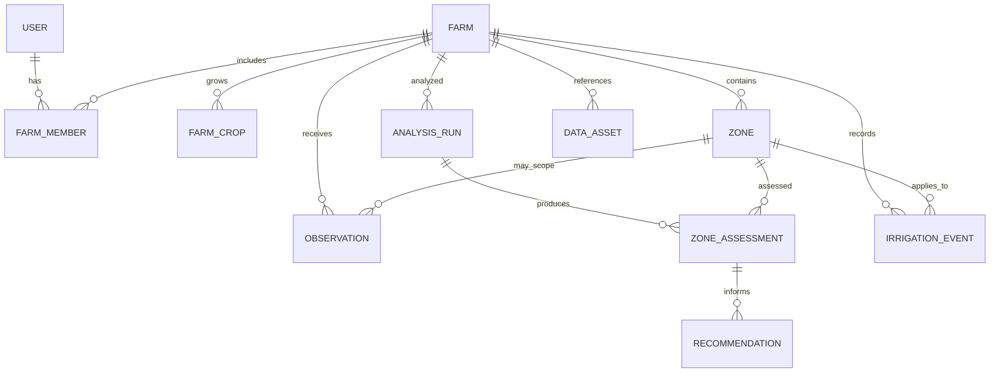

# Data Model Specification

**Primary database:** PostgreSQL + PostGIS  
**Geometry boundary format:** GeoJSON / WGS84 (EPSG:4326)  
**Canonical API timestamps:** RFC 3339 UTC timestamps

## 1. Modelling principles

- Separate source observations from derived assessments and recommendations.
- Preserve data provenance and quality.
- Store stable machine enum values; translate only in the frontend.
- Use explicit units in column/API names or data dictionaries.
- Store geometry with a known SRID and validate it.
- Record analysis version and input references so a result can be reproduced.
- Do not store fabricated default measurements for missing values.

## 2. Core entities and relationships

## 3. Entities

### User

- `id` UUID primary key
- `display_name` string
- `phone_e164` nullable; store only if needed for authentication/contact
- `preferred_language` enum: `en`, `mr`, `hi`
- `created_at`, `updated_at`

Do not store unnecessary personal data. Authentication credentials/tokens must be handled by a dedicated security mechanism, not plain-text fields.

### Farm

- `id` UUID
- `name` string
- `owner_user_id` UUID
- `location_name` string nullable
- `centroid` geography point nullable
- `boundary` MultiPolygon/Polygon geometry, SRID 4326
- `area_ha` numeric; calculated from geometry using appropriate geodesic/projected method and optionally farmer-confirmed
- `timezone` IANA timezone identifier
- `created_at`, `updated_at`

### FarmMember

- `farm_id`, `user_id`
- `role` enum: `owner`, `farmer`, `agronomist`, `viewer`
- unique pair `(farm_id, user_id)`

### FarmCrop

- `id` UUID
- `farm_id` UUID
- `crop_name` canonical string/code
- `variety` nullable
- `sowing_date` nullable date
- `growth_stage` canonical enum/string plus source (`farmer_input` or `estimated`)
- `irrigation_method` enum/string (e.g. `drip`, `sprinkler`, `surface`, `other`, `unknown`)
- `root_depth_m` nullable numeric
- `kc_value` nullable numeric plus crop reference/source/version and stage
- `active_from`, `active_to` nullable

### Zone

- `id` UUID
- `farm_id` UUID
- `name` string (e.g. Zone A)
- `geometry` Polygon/MultiPolygon SRID 4326
- `area_ha` numeric
- `definition_method` enum: `user_drawn`, `imported`, `algorithm_suggested`
- `status` active/archived
- `created_at`, `updated_at`

For MVP, manual or pre-prepared zones are acceptable. Algorithm-suggested zones must not be implied unless actually generated and reviewed.

### Observation

- `id` UUID
- `farm_id` UUID
- `zone_id` UUID nullable (null means farm-level/grid-level observation)
- `variable_code` string (e.g. `ndvi`, `precipitation_mm`, `et0_mm_day`, `soil_moisture_m3_m3`)
- `value_numeric` nullable numeric
- `value_text` nullable string
- `unit` string nullable
- `provenance_type` enum: `sensor_measured`, `provider_modelled`, `satellite_derived`, `farmer_entered`, `calculated`, `simulated`
- `source_provider` string
- `source_reference` string nullable (scene ID, API model/run, sensor ID or record reference)
- `observed_at` timestamp nullable
- `retrieved_at` timestamp
- `valid_from`, `valid_to` nullable timestamps for forecast values
- `spatial_resolution_m` numeric nullable
- `depth_min_cm`, `depth_max_cm` numeric nullable
- `quality_status` enum: `good`, `suspect`, `cloud_contaminated`, `missing`, `stale`, `simulated`
- `quality_metadata` JSONB
- `processing_version` string nullable
- `created_at`

A unique policy for observations should be defined by variable/source/time/geometry scope to prevent accidental duplication. Do not assume every provider row is unique.

### DataAsset

Metadata for raster, image, GeoJSON or derived file stored outside the database:

- `id` UUID
- `farm_id` UUID
- `zone_id` nullable UUID
- `asset_type` enum/string (`sentinel2_scene`, `ndvi_raster`, `zone_layer`, etc.)
- `storage_uri` string
- `checksum` string nullable
- `content_type` string
- `source_provider`, `source_reference`
- `acquired_at`, `created_at`
- `crs`, `spatial_resolution_m`, `bounds` metadata
- `quality_metadata` JSONB

### AnalysisRun

- `id` UUID
- `farm_id` UUID
- `status` enum: `queued`, `running`, `succeeded`, `partial`, `failed`
- `triggered_by` UUID nullable
- `started_at`, `completed_at`
- `analysis_version`
- `input_manifest` JSONB (IDs/versions of observations and assets used)
- `error_code`, `error_message` nullable

### ZoneAssessment

- `id` UUID
- `analysis_run_id` UUID
- `farm_id`, `zone_id` UUID
- `status` enum: `healthy`, `monitor`, `attention`, `high_stress`, `insufficient_data`
- `stress_score` numeric nullable (only if a documented scoring method is implemented; otherwise omit)
- `evidence_summary` JSONB
- `data_quality_status` enum: `good`, `partial`, `stale`, `insufficient`
- `assessed_at`
- `method_version`

### Recommendation

- `id` UUID
- `analysis_run_id`, `farm_id`, `zone_id` UUID
- `action_code` enum/string: `irrigate`, `monitor`, `delay_and_reassess`, `inspect`, `no_action_indicated`, `insufficient_data`
- `priority` enum: `low`, `medium`, `high`, `urgent`
- `water_depth_mm` nullable numeric
- `water_volume_m3` nullable numeric
- `recommended_window_start`, `recommended_window_end` nullable timestamps
- `reason_codes` JSONB/string array
- `assumptions` JSONB
- `evidence_observation_ids` JSONB/string array
- `uncertainty_note` nullable string
- `calculation_version`
- `created_at`, `superseded_at` nullable

Water depth and volume must remain null if the calculation inputs are insufficient.

### IrrigationEvent

- `id` UUID
- `farm_id`, `zone_id` UUID nullable
- `recorded_by` UUID
- `occurred_at` timestamp
- `water_depth_mm` nullable numeric
- `water_volume_m3` nullable numeric
- `duration_minutes` nullable integer
- `method` string/enum nullable
- `source` enum: `farmer_recorded`, `sensor_recorded`, `imported`
- `notes` nullable string
- `created_at`

Farmer-reported actions must not be represented as independently verified sensor readings.

## 4. Geometry constraints

- Boundary and zone polygons must be valid.
- Zone geometry must be contained within its farm boundary (allow documented tolerance for geometry precision).
- Store geometry with SRID 4326.
- Use GiST spatial indexes for geometry columns.
- Do not calculate area directly from longitude/latitude degree values.
- Keep original GeoJSON/geometry version if editing zones would otherwise erase historical context.

## 5. Indexes and constraints

Initial indexes to consider:

- `farms(owner_user_id)`
- `farm_members(user_id, farm_id)`
- `zones(farm_id)` and GiST on `zones(geometry)`
- `observations(farm_id, variable_code, observed_at DESC)`
- `observations(zone_id, variable_code, observed_at DESC)`
- `analysis_runs(farm_id, started_at DESC)`
- `recommendations(zone_id, created_at DESC)`
- `irrigation_events(farm_id, occurred_at DESC)`

Use foreign keys, not-null constraints and check constraints for valid ranges/units where meaningful. Exact migration implementation belongs to Chaitanya.

## 6. Data dictionary governance

New variables must be added to `docs/DATA_SOURCES.md` or a dedicated data dictionary with:
- canonical code;
- definition;
- unit;
- provenance type;
- spatial/temporal resolution;
- valid range or quality rule;
- provider/source;
- whether suitable for farmer-facing recommendation.
